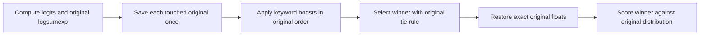

# One logit buffer, exact confidence

**Host-verified candidate. Not installed on AckermanOS hardware.**

| Check | Result |
| :--- | :--- |
| ✅ Decoder peak heap | **32,772 bytes lower** on the locked 8,193-row English artifact |
| ✅ Synthetic speech | Same transcript, token IDs and exact hexadecimal confidence score, with and without keywords |
| ✅ Keyword boundaries | 4,096 full-vocabulary comparisons; 372 at full keyword capacity |
| ✅ Target compiler | Actual Watch66 Xtensa flags compile both objects; text grows 17 bytes; object data/BSS unchanged |
| ☐ Physical acceptance | Full firmware size, live stack margin and device speech replay remain required |

## How it works

The decoder previously allocated two float arrays for all vocabulary logits.
Only keyword bias mutates the logits before selection. At most one value changes
per keyword sequence, so save each distinct original in a bounded undo list.
Apply additions in their original order, select the same winner, restore the
exact float values, and score that winner against the original distribution.
Subtracting bonuses would not reliably reverse floating-point rounding.



The old allocation was 32,772 heap bytes for 8,193 floats. The undo list occupies
256 automatic bytes at the default capacity of 32 keyword sequences. Target
compiler reports a decode-pass frame of 3,440 bytes, previously 3,184; its caller
frame changes from 64 to 48 bytes. These are individual compiler frame reports,
not measured whole-task peak stack or a physical high-water reading.

This optimization changes no model weights, token IDs, decoder limits or language
controls. It does **not** prove monolingual weights or better speech accuracy.
The recorded heap measurement covers allocations made during decoding, excluding
already resident model, tokenizer and encoder allocations.

## Reproduce

Run the CMake host suite, including `decoder_confidence_memory`. The regression
compares production scoring with the previous scorer, including shared targets,
already-said groups, prefix continuation, EOS, ties, negative bonuses and tiny
bonuses lost to rounding. Address/undefined sanitizer execution passed on Bak.
The existing five host executables and five exporter structural cases also pass;
they were invoked directly because Bak has no CMake/CTest installation.

For a local 16 kHz mono PCM16 synthetic WAV and the locked English artifact:

```sh
python3 tools/check_decoder_memory.py model/whistle_d2_en.cact smooth-16k.wav \
  --baseline 4542da71aa628a3381b4fcbec7ea52353f4487bd --report decoder-memory.json
```

The script compiles the baseline and current decoder with one host compiler,
wraps allocation/free calls only during decode, checks peak and final live bytes,
and compares transcript, token IDs and exact confidence. It downloads nothing,
creates no device connection, and refuses to overwrite the report. This script
requires the baseline Git object and a C compiler; no NumPy dependency is needed.

[Measured evidence](../evidence/decoder-memory-20261029.json).
