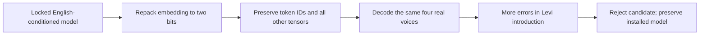

# Two-bit embedding: smaller, rejected

**2026-10-30 · Host-only experiment · Do not deploy this conversion.**

| Check | Baseline | Untuned conversion |
| :--- | ---: | ---: |
| Model file | 10,662,177 bytes | 9,613,473 bytes |
| Tied embedding precision | 4-bit | 2-bit |
| Levi introduction word errors | 2 / 12 | **5 / 12** |
| All four clips, word errors | 3 / 37 | **6 / 37** |
| Release decision | Existing locked model retained | ❌ Rejected |

The model file shrinks by **1,048,704 bytes**. The four fixed YouTube clips
expose a regression on the character-name introduction. Both models still match
two clips exactly; that coarse pass count would hide the increased errors.
This tiny cohort is a regression probe, not a general speech-accuracy estimate.
[Exact sizes, hashes and per-case counts](../evidence/embedding-two-bit-20261030.json).

The experiment maps each existing four-bit codebook entry to its nearest
two-bit codebook value. It retains group-norm bytes, token IDs, tokenizer,
language control, shared codebooks and every other tensor payload. Native host
decoding confirms that the existing engine can load this representation.
The conversion is lossy and untuned; it is not quantization-aware training or
an optimal two-bit quantizer. Its failure does not rule out a properly trained
two-bit model. It also does not remove multilingual neural knowledge.

Raw candidate files and comparison transcripts stay in retained Bak artifacts:
`/srv/ai/artifacts/ackerman-os/embedding-2bit-20261030/`. Git contains the converter
and numeric evidence. `tools/experiment_embedding_bits.py` accepts only the
locked input hash, refuses existing output paths and checks retained bytes.

No signed target, model profile, device partition or installed firmware changed.
File-size savings do not prove newly usable flash space on either board. Follow
the [English corpus and vocabulary work](english-corpus.md) for the next model
training stage; accuracy and native/target acceptance remain required.
