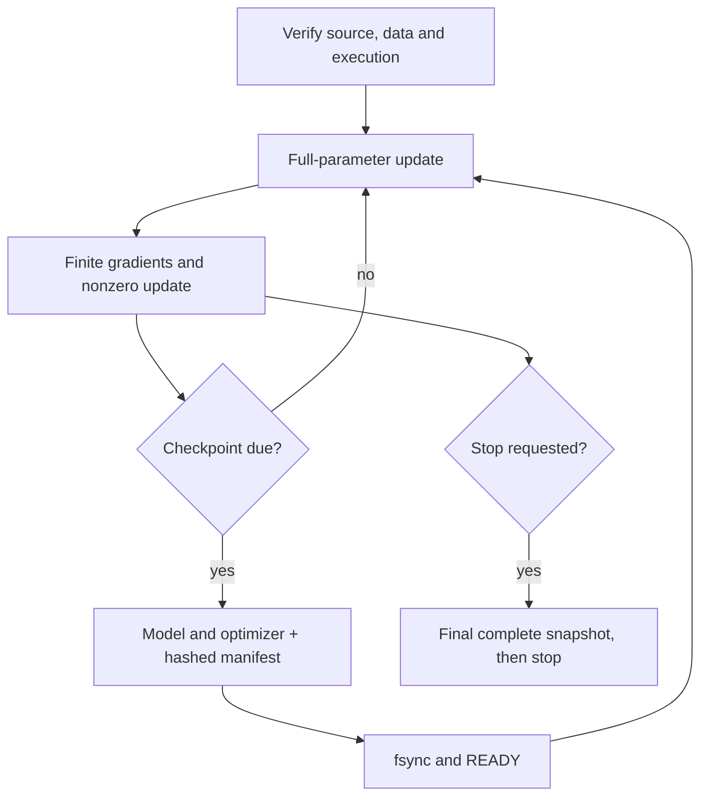

# English student: periodic checkpoints and guarded acceleration

**The new runner saves complete model/optimizer snapshots during training.**
The original CPU trainer remains unchanged for its existing checkpoints.

| Capability | State | Evidence |
| :--- | :--- | :--- |
| Global-step checkpoint cadence | ✅ 12 control tests pass | Cadence, stop signals, backend proof and drift refusal |
| Real periodic saving | ✅ CPU checkpoints 1 and 2 complete | Full 29,537,627-parameter model + Adam state |
| Training arithmetic preserved | ✅ Exact CPU reference match | Every parameter array and optimizer bytes match step two |
| New-process resume | ✅ CPU update 3 complete | Model + optimizer restored from checkpoint 2; checkpoint 3 verified |
| Guarded CUDA training path | ✅ First finite full-parameter update completed | Actual recoverable GPU checkpoint and new-process resume still pending |

`tools/train_english_accelerated.py` reuses the original data validation,
sampling, source verification and durable writer. Its separate execution
signature records runner/helper/control hashes, backend, precision and package
versions. CPU remains the default and explicitly hides CUDA devices.

CUDA mode requires a current parent admission guard and a prior successful
backend smoke on that GPU. Checker/lock/admission hashes and installed package
versions must match. Missing proof, CPU fallback and drift are refused before
JAX import. A validated GPU backend does not establish Whistle training accuracy.

## Checkpoint behavior

| Option | Behavior |
| :--- | :--- |
| `--checkpoint-every` | Global-step cadence; default 1,000 |
| `--resume` | Verify and restore model + optimizer from a complete snapshot |
| `--checkpoint-reserve-gib` | Keep spare disk before writing; default 2 GiB |
| `--backend` | CPU by default; CUDA requires the admission guard |
| `--gpu-backend-receipt` | Required successful smoke evidence for CUDA |

A final checkpoint is saved once even when it coincides with a periodic save.
Every snapshot has its own directory. Partial writes retain `INCOMPLETE`;
complete snapshots have verified files, a manifest and `READY`. Earlier snapshots
are never overwritten. Source or optimizer changes cannot silently resume a run.

SIGTERM/SIGINT set a stop request. The loop checkpoints at a completed step
boundary and records whether all requested steps finished. If the resource guard
must kill an in-flight job before saving completes, the previous `READY`
snapshot remains authoritative. A stop request is not a promise that the latest
in-flight update reached disk.

## Compatibility and current scope

Use `tools/train_english_student.py` for its existing CPU checkpoints. That file
is byte-for-byte preserved. New accelerated checkpoints use the new runner and
its exact signature; they are not silently converted from old runs. Checkpoint
cadence is run metadata, so it can change across a compatible resume.

The CPU regression uses two short public training clips and completed three
updates across processes. It verifies training machinery, not convergence,
speech recognition or meaningful full-corpus training. No research export is
approved for Watch deployment.

The [whole audio audit](english-training-readiness.md) now verifies all 33,844
clips in the fully staged cache. Repeat it if the cache changes before a full run. The runner checks each loaded clip's hash and refuses
truncation; the full-cache audit is a separate readiness gate.

[Exact checkpoints, reference comparison and resource receipts](../research/english-accelerated-checkpoints-20261031.json).

The initial accelerated attempt failed before model allocation because of a
missing import; its output/source are retained. The corrected fresh run took
362 seconds with a 4.11 GB process-group peak; resume took 245 seconds with
3.43 GB. These include compilation/checkpoint I/O, not target inference timing.
The two-core guards kept a 1 GiB host floor and did not evict other workloads.

**Next:** validate the CUDA student path. The real
[GPU backend admission and numeric checks](english-gpu.md) now pass. Keep full numeric, held-out
native speech and physical Watch acceptance open.

## Save the optimizer without a full host copy

The first real CUDA update completed with finite gradients and a nonzero
parameter update. Saving its optimizer then exceeded the 3.5 GiB host cap;
the partial directory retains `INCOMPLETE` and cannot be resumed.
[Exact first-update and failed-save evidence](../research/english-first-gpu-update-20261031.json).

`--stream-checkpoints` is an optional writer that emits the same Flax msgpack
format one array at a time. It preserves the model format, optimizer values,
fsync/hash/READY ordering and existing readers. The original CPU trainer is
unchanged. The option and writer source hash enter the accelerated signature,
so earlier checkpoints still require their recorded source/options.

| Control | Result |
| :--- | :--- |
| Flax optimizer bytes, including chunked arrays | ✅ Bit-identical |
| Actual Adam restore and next update | ✅ Bit-identical |
| Failed or short output | ✅ Refused; no READY |
| Existing checkpoint / changed bytes | ✅ Preserved / refused |
| Full GPU checkpoint under the cap | ⬜ Still needs actual execution |

A streamed save retains only a serialized leaf at a time instead of a full
host optimizer tree and complete packed payload. This bounds that part of
serialization by its largest leaf; the model writer, live state and compiler
allocations still contribute to total RSS.
[Five CPU controls and resource receipt](../research/english-checkpoint-stream-controls-20261031.json).

Separate guarded CPU processes now compare the full student geometry with
synthetic initial Adam moments. Both produce exactly 236,308,569 bytes with the
same SHA-256. Observed process peak RSS falls from 1,102,770,176 to 794,017,792
bytes: about 294 MiB less. Only one optimizer leaf (largest encoded leaf
37,748,763 bytes) is serialized at a time. The optimizer state digest remains
unchanged. These are CPU writer measurements, not actual trained-GPU save/resume
acceptance.
[Full-geometry memory and exact-file evidence](../research/english-checkpoint-stream-memory-20261031.json).

Reproduce with separate guarded invocations of
`tools/check_english_checkpoint_memory.py --mode legacy` and `--mode stream`,
supplying the same model, pinned Needle source and fresh output directories.
A readable model from the failed save is used only for its array geometry; this
measurement does not turn that incomplete directory into a resumable snapshot.
