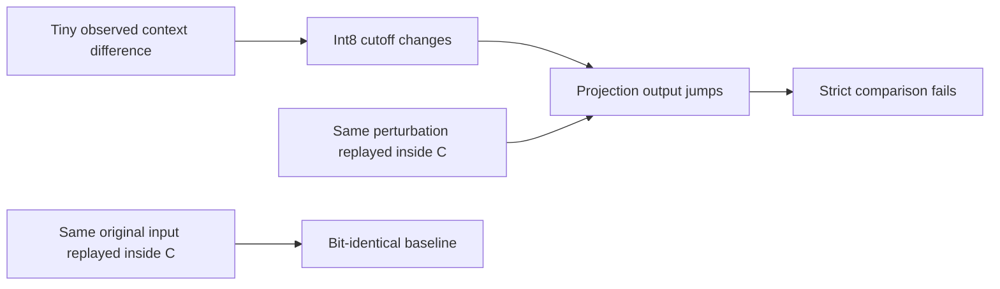

# English fast inference: the C kernel reproduces the jump

**A tiny context difference crosses an int8 rounding boundary in this test.**
The same observed perturbation reproduces the projection jump inside C.

| Controlled comparison, eighth fixed token | Result |
| :--- | :--- |
| Capture vs original composed calculation | ✅ Exact |
| Reference context codes vs native baseline | ⚠️ One code differs |
| Context perturbation replayed in C | 5.071e-7 relative input change → 0.00104577 output change |
| Reference output vs perturbed native output | ✅ Relative difference 3.46e-7; error-vector cosine 0.999999946 |
| Compiler barrier after normalization | ☐ Does not fix this case |

This supports **rounding-boundary sensitivity for this case**. It does not
establish held-out recognition accuracy, resolve every whole-network difference
or justify relaxing the numeric gate. These are eight fixed comparison tokens
and a model with only two optimizer steps, not a usable recognizer.

## What changed

`tools/english_cross_composition.py` compares ordinary composed
normalization/cross-attention, the same graph with captured intermediates, and
an experimental compiler barrier after normalization. The captured calculation
matches ordinary execution exactly. All three miss the strict limit at token
eight. The ineffective barrier remains diagnostic code, not a training change.

`tools/check_english_context_replay.py` feeds the actual C projection both the
retained native context and the observed reference context. The native baseline
must reproduce retained projection bytes exactly before attribution is allowed.
The perturbed C output reproduces the reference error vector. Context-code counts
come from the reference quantizer against captured C codes; they are distinct
from the independently measured native projection replay.

Both jobs completed on two CPU cores at reduced priority. The composed probe
peaked at 1.40 GB process-group RSS; the replay completed without a JAX model
load. No checkpoint, optimizer, native arithmetic, training policy, installed
model or device state changed.

[Exact numeric, source and resource receipts](../research/english-cross-composition-20261031.json).

## Next milestone

Prepare meaningful native-policy training when Alienware resources are free,
using these controls to distinguish model/export errors from cutoff sensitivity.
Preserve the failed strict numeric gate; it remains open alongside held-out
native recognition, Watch memory/stack and physical microphone acceptance.
Do not deploy the two-step research export.
