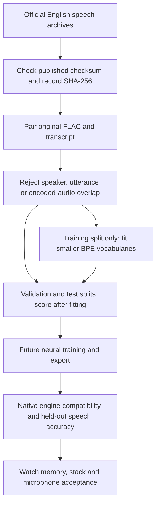

# Smaller English model: data and vocabulary work

**Research resumed 2026-10-30 · No replacement speech model produced or deployed.**

The parent reactivated the Watch/English goal. [The previous pause checkpoint](../PAUSED.md)
is retained as history; unrelated holds remain in force.

| Stage | State | Completion evidence |
| :--- | :--- | :--- |
| ✅ Corpus preparation code | Checks official archive checksums, paired text/audio and disjoint splits | Nine focused corpus tests |
| ✅ Tokenizer admission code | Rejects changed manifests, non-English metadata and split leakage; actual native trainer smoke passes | Six admission tests plus native integration; all nine CTest suites pass |
| ⏳ English speech corpus | All three archives downloaded and checksum-verified; preparation is running | Full extraction and disjoint-split report required |
| ☐ Smaller English vocabularies | Fit 8,192 / 4,096 / 2,048-piece candidates on training text only | Held-out token counts and exact text round trips required |
| ☐ Real English speech model | Neural retraining, export, native compatibility and accuracy acceptance remain | No candidate may replace the locked firmware model yet |



## Corpus source

[LibriSpeech, OpenSLR12](https://www.openslr.org/12/) supplies read English audio
with aligned transcripts under CC BY 4.0. Credit Vassil Panayotov, Guoguo Chen,
Daniel Povey and Sanjeev Khudanpur, *LibriSpeech: an ASR corpus based on public
domain audio books* (2015). Original license text is retained during extraction.
Use `train-clean-100` for training, `dev-clean` for validation and `test-clean`
for held-out evaluation. Published archive MD5 values are pinned from the
[official checksum file](https://openslr.trmal.net/resources/12/md5sum.txt).
Local SHA-256 receipts identify exact cached bytes. This is source-data integrity,
not a firmware trust/signing mechanism.

```sh
python3 tools/prepare_english_corpus.py \
  --archive-dir /srv/ai/cache/datasets/librispeech \
  --audio-dir /srv/ai/cache/datasets/librispeech/english-corpus-20261029 \
  --output /srv/ai/artifacts/ackerman-os/english-corpus-20261029/prepared
```

Use fresh output paths; interrupted attempts are retained with `INCOMPLETE` and
must not be trained on. Original files and transcripts are never truncated.
Clips over the configured duration limit are excluded whole. Default limit is
30 seconds, matching Whistle's training window; an eight-second eligible count
is also recorded for the Watch capture limit. Speaker/utterance/hash leakage
checks include excluded clips. FLAC sample rate, channels, bit depth and sample
count are checked through STREAMINFO. Preparing manifests does not fully decode
every audio file or independently re-audit every spoken word.

JSONL rows include `audio`, `text`, `language: en`, source identity, speaker and
audio SHA-256. The manifests retain original casing. Their receipt records
counts, retained hours, excluded clips and manifest hashes. These files contain
public corpus data, never family conversations or notebook uploads.

## Vocabulary experiment

The working isolated environment is Python 3.12.16 with SentencePiece 0.2.2,
under `/srv/ai/cache/venvs/ackerman-english-py312-20261030/`. System Python and
global DNS were not changed. Package/interpreter hashes, the compiler overrides
and the offline build patch are in [the resumed evidence](../evidence/english-research-resumed-20261030.json).
The patch makes CMake use Abseil already bundled in the verified source archive;
no library C++ source was changed. `CC`, `CXX` and `LDSHARED` explicitly select
Bak's installed GCC rather than the interpreter's original Clang build defaults.

`tools/check_english_tokenizer.py` exercises the real trainer with the same
options as the corpus job. It catches native assertions that pure metadata
tests cannot detect. Byte fallback passes unseen-name, UTF-8 and apostrophe
round trips with zero unknown tokens. Do not add unused `required_chars`: the
pinned BPE implementation asserts when those characters have zero frequency.
The CTest driver includes this integration check when SentencePiece is available.

```sh
/srv/ai/cache/venvs/ackerman-english-py312-20261030/bin/python tools/train_english_tokenizer.py \
  --corpus /srv/ai/artifacts/ackerman-os/english-corpus-20261029/prepared \
  --output /srv/ai/artifacts/ackerman-os/english-corpus-20261029/tokenizers
```

This trains new BPE tokenizers using training-split text with deterministic
original/lowercase/sentence-case views. Validation and test text never fit the
vocabulary. Special IDs remain pad0/eos1/bos2/unk3; byte fallback preserves
unseen names and UTF-8 text. All held-out text views must round-trip exactly
without unknown tokens. [SentencePiece options](https://github.com/google/sentencepiece/blob/master/doc/options.md)
explain these controls. Exact package version, options, input and output hashes
are retained; reproducibility is scoped to those pinned tools and platform.

New token IDs change Whistle's embedding and Engram-history semantics. These
tokenizers cannot be substituted into existing weights. Current native language
prefix geometry and signed model guards also require explicit adaptation for a
new vocabulary. The report therefore marks firmware compatibility and deployment
permission false. Existing English-conditioned model bytes remain unchanged.

Reported row/logit savings are arithmetic estimates at the current row format,
not an exported whole-model measurement. A smaller vocabulary can require more
tokens per word and increase decoding work. Those costs must be measured against
accuracy, latency, flash and RAM after neural training. English source text alone
does not prove that multilingual neural knowledge has been removed.

Physical speech tests continue to use the separately cached YouTube clips.
Read-audiobook results do not establish spontaneous child-speech accuracy.
