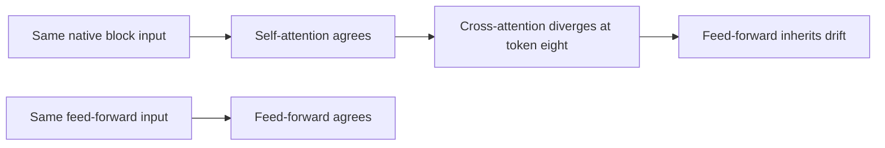
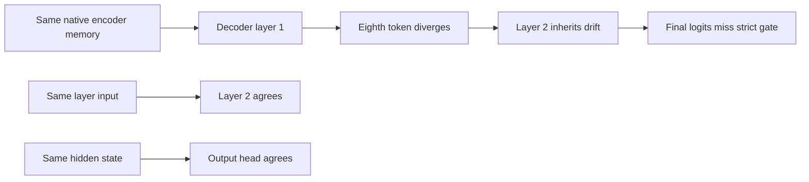

# English decoder: where fast inference diverges

**Cross-attention in the first decoder layer diverges at the eighth tested token.**
Self-attention and feed-forward agree when given identical inputs.

| First-layer operation, identical inputs | Result | Maximum relative error |
| :--- | :--- | :--- |
| Self-attention | ✅ Pass | 3.99e-7 |
| Cross-attention | ☐ Token eight fails | 0.00064471 |
| Feed-forward | ✅ Pass | 1.94e-8 |
| Float control, all 64 comparisons | ✅ Pass | 7.22e-7 |
| Captured vs original training block | ✅ Exact | 0 |

The isolated cross-attention comparison includes the clip memory and its cached
K/V construction. It does not yet distinguish a projection cutoff from a query,
key, value, normalization or memory-construction difference.

[Exact sublayer, source-integrity, sanitizer and resource receipts](../research/english-decoder-sublayers-20261031.json).

## Layer boundary controls

| Boundary | Result | What it establishes |
| :--- | :--- | :--- |
| Native probe vs original native logits | ✅ Bit-identical | The host trace preserves actual decoder behavior |
| First seven tested hidden states | ✅ Agree | The discrepancy appears later in this fixed sequence |
| First layer, eighth token, identical inputs | ☐ Relative error 0.00047049 | The mismatch is local to this layer |
| Second layer, identical inputs | ✅ Maximum relative error 3.07e-7 | Its cumulative difference is inherited |
| Output head, identical hidden states | ✅ Maximum logit difference 2.87e-6 | The earlier decoder error is not caused by the final projection |

These are **eight fixed comparison tokens**, not recognized words. The model
has only two optimizer steps. This diagnosis establishes neither useful speech
recognition nor Watch speed, memory or microphone performance. The full fast
network still fails; no research model has been deployed.

## How the comparison stays controlled

`host/decoder_probe.c` includes the existing engine and copies only the small
decoder orchestration to save lane states between unchanged production
operations. `tools/check_english_decoder.py --layers` refuses results unless
the final native logits reproduce the retained native run bit for bit.

`tools/english_decoder_layers.py` executes the pinned training model's layer
code. Each layer is compared in two ways: cumulative output and output using
the exact native layer input. This separates inherited drift from a local
discrepancy. The traced training calculation must also agree with the original
training calculation **at every token**, within a stricter 2e-6 relative control.
The measured maximum is 1.49e-7. Native acceptance remains 2e-4 relative / 0.002
absolute logits; those limits have not changed.

The earlier boundary-only probe is described in
[its exact receipt](../research/english-decoder-boundary-20261031.json).
It reproduced native execution in fast and float modes, localized the eighth
hidden-state error to 0.00028843, and passed all eight float hidden states.
The layer probe narrows that finding further.

The expanded probe passes actual-model execution and malformed-input/output
preservation checks under Zig ASAN/UBSAN. The float layer control passes all
32 comparisons. CPU guards were bounded to two cores, 3 GiB and five minutes;
all jobs completed without eviction or GPU allocation.

[Exact layer, token, sanitizer and resource receipts](../research/english-decoder-layers-20261031.json).

## Host-only operation captures

`tools/prepare_decoder_trace.py` creates a build-local engine copy with exactly
five capture calls inside the decoder block. Production engine source is never
edited. Four source-integrity tests prove that removing those calls restores
the original bytes and refuse missing or ambiguous anchors. Build receipts hash
the engine, generator and generated source.

The capture subclass uses the pinned training operations and refuses attribution
unless its output agrees with the original block at every token within 2e-6.
Both fast and float controls are exact in this run. Native logits still reproduce
the previous run bit for bit. The generated probe also passes eight actual-model,
malformed-input and output-preservation checks under Zig ASAN/UBSAN.

## Next action

Compare cross-attention Q/K/V, cached memory and output projection at the eighth
token. Preserve the passing self-attention, feed-forward and output-head controls;
do not change acceptance limits.
