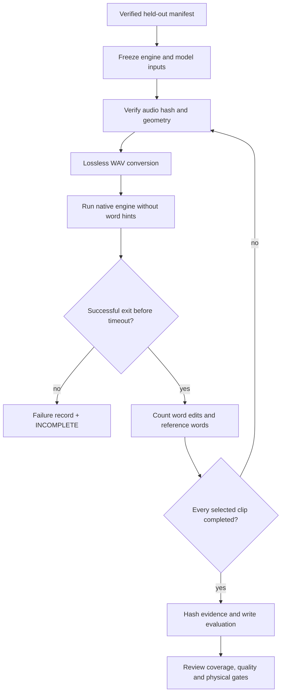

# English recognition: measure the result, keep failures visible

**A completed training run is not a usable recognizer until held-out speech passes.**

| Check | Status | What it covers |
| :--- | :--- | :--- |
| Held-out data | ✅ Controls pass | Validation/test only; manifest hashes and split leakage rechecked |
| Original audio | ✅ Controls pass | Exact audio hash, mono 16 kHz PCM16, every sample retained |
| Engine errors | ✅ Controls pass | Crash/nonzero exit/timeout stops evaluation and retains `INCOMPLETE` |
| Honest totals | ✅ Controls pass | Corpus-weighted word error rate; empty speech output counts as errors |
| Native integration | ✅ Four real validation clips completed | Existing model only; subset, not full-split or model acceptance |

Nine synthetic controls exercise these rules. They are not speech-recognition
results. A separate guarded GCC build of the actual native engine completed
the four-clip integration run. Its existing-model result is a pipeline baseline,
not evidence for the new student's quality.



## Run it

Use the locked CPU environment and the host storage environment. Give every
run a fresh output directory under the workdata workspace. This command reads
files; it does not play audio, open a microphone, connect to Bak or deploy a model.

```sh
python tools/eval_english_native.py \
  --corpus "$CORPUS" --split validation \
  --model "$EXPORTED_MODEL" --engine "$NATIVE_WH_RUN" \
  --audio-source-root "$RECORDED_SOURCE_ROOT" \
  --audio-local-root "$VERIFIED_LOCAL_AUDIO" \
  --output "$FRESH_EVALUATION_OUTPUT"
```

Default `--limit 0` scores the complete selected split. A bounded integration
check can use `--limit 4 --seed 0`; the report explicitly marks it as a subset.
The deterministic selection can be reused when comparing models. Use validation
while iterating and reserve the test split for the chosen candidate. The corpus
is disjoint for this student; an older model's training-data provenance is
outside this scorer's evidence.

The tool freezes copies of the model and executable before inference. Every
audio source is hash-checked and decoded without trimming or resampling.
The native command receives only audio, the model, English and decoder depth;
reference text and keyword hints are not supplied to the engine.

## Read the result

| File | Meaning |
| :--- | :--- |
| `plan.json` | Split, selection hash, normalization and frozen input identities |
| `utterances.jsonl` | Each reference/hypothesis, audio hashes, word errors and timing |
| `progress.json` | Partial totals; never a final score |
| `evaluation.json` | Complete selected-run totals, coverage and evidence hashes |
| `INCOMPLETE` / `failure.json` | Failed/interrupted run; not accepted as a completed score |

`read_evaluation()` refuses incomplete runs or changed frozen inputs/ledger
bytes. Word normalization uses Unicode NFKC, case folding, punctuation as spaces
and internal apostrophes. WER is total word edits divided by total reference
words, rather than the average of per-clip percentages. A valid empty hypothesis
counts all missing reference words; an engine failure does not become a valid
empty transcript.

Every result retains `recognition_accuracy_accepted=false` and
`deployment_permitted=false`. Scoring does not waive native numeric, memory,
physical microphone, latency, power or release gates.

[Control and actual integration receipts](../research/english-native-evaluation-20261031.json).


## Test discovery and the complete baseline

The scorer controls use the native project's `test_english_*.py` discovery
pattern. Standard-library-only discovery runs the pure metric checks and
reports missing research dependencies as explicit skips. The locked CPU
environment runs all nine scorer and five checkpoint controls without skips.
The current discovery check runs 77 tests with 18 dependency skips; those skips
do not establish model or audio acceptance.
[Discovery and complete research-environment controls](../research/english-native-evaluation-discovery-20261031.json).

A complete validation baseline of the existing model is now running under a
two-core, 1 GiB CPU guard. It includes all 2,694 validation clips, uses the same
seed and normalization as the four-clip integration check, and preserves every
clip. Its output is private ignored build storage until the run completes.
Partial WER remains progress only. This baseline will not approve new weights.
