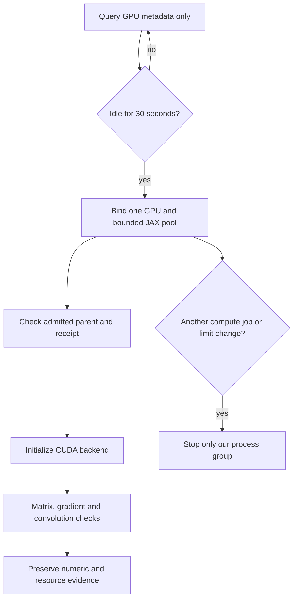

# English GPU runner: wait first, then verify

**✅ Real CUDA matrix, gradient and convolution checks pass on the RTX 3070.**

| Requirement | State | Scope |
| :--- | :--- | :--- |
| Separate environment | ✅ 51 locked versions match | Existing CPU environment preserved |
| GPU admission/process guard | ✅ 13 tests pass | Simulated GPU telemetry + real process isolation |
| Backend parent/device binding | ✅ 4 tests pass | Refuses unadmitted processes, wrong devices and allocation overrides |
| Real GPU backend smoke | ✅ Actual guarded execution passes | Terminal guard exit 0; no CPU fallback |
| Guarded student runner | ☐ First compile exceeded host cap | Full model initialized; no completed student update |



The first three-minute window ended without a child because GPU utilization
exceeded admission. Its queued successor was explicitly stopped before any
child launched. A third bounded diagnostic window allowed 35% utilization for
the tiny backend check after confirming graphics-only activity and spare GPU
memory; its memory budgets and 30-second dwell were unchanged. It also ended
without a child: available host RAM was below the 5 GiB launch requirement.
Those early windows did not initialize CUDA. The successful sixth window used
a stricter 2 GiB diagnostic host cap, retaining the 2 GiB launch reserve and
1 GiB runtime floor. It admitted after 30.32 seconds and finished in 42.75 seconds.
Full training retains the default 10% utilization ceiling. No other workload was
paused or evicted.

| Actual CUDA check | Maximum absolute error | Result |
| :--- | ---: | :--- |
| Matrix multiplication | 5.72e-6 | ✅ Existing tolerances pass |
| Gradient | 3.58e-7 | ✅ Existing tolerances pass |
| Convolution | 2.38e-7 | ✅ Existing tolerances pass |

Observed process-group peaks were 1,315,704,832 bytes host RSS and
2,250,244,096 bytes GPU memory. All 51 installed versions, checker/lock hashes
and the preserved admission snapshot were revalidated after completion.
This proves this backend, not student training or recognition accuracy.

[Actual CUDA result and final resource receipt](../research/english-gpu-backend-20261031.json).

[Installation and initial admission](../research/english-gpu-admission-20261031.json).
[Terminal diagnostic and full-data evidence](../research/english-full-corpus-readiness-20261031.json).

## Admission and ownership

`tools/guard_english_gpu_job.py` requires sustained GPU utilization at or below
10%, no compute process on the selected GPU, and spare GPU/host memory. Busy
samples reset the idle window. A cooperative per-device file lock prevents two
copies of this guard from reserving the same device. Device UUID binding survives
index changes; receipts use a fingerprint rather than exposing the UUID.

Defaults require 3 GiB GPU budget plus 2 GiB reserve, and 3 GiB host RSS budget
plus 2 GiB launch reserve. Runtime withdrawal checks cover other compute arrivals,
owned GPU usage, free GPU memory, group RSS, free host memory, elapsed time and
telemetry failure. Only the owned process group receives signals.

These are sampled withdrawal thresholds, **not a hardware memory partition**.
GPU activity can change between samples. The guard does not evict or suspend
other jobs. Unit tests verify decisions with simulated GPU samples; their real
process tests demonstrate that withdrawing an owned child preserves an unrelated
process. Successful tests do not establish actual CUDA execution.

## Allocation, caches and smoke checks

The guard binds `CUDA_VISIBLE_DEVICES` to one device and gives JAX a 2 GiB BFC
pool by default. The fraction sizes that pool, not all driver/library allocations;
whole-process usage is monitored separately. JAX, CUDA and Triton caches are
explicitly placed under the supplied workdata cache root. The child does not
inherit alternate allocators, CUDA-version-check bypasses or `LD_LIBRARY_PATH`.
See the [JAX memory guide](https://docs.jax.dev/en/latest/gpu_memory_allocation.html).

`tools/check_english_gpu_backend.py` checks its actual parent process, running
admission receipt, selected device, pool settings and all installed lockfile
versions **before importing JAX**. It refuses CPU fallback or multiple visible
GPUs. The numeric smoke checks matrix multiplication, a gradient and a small
convolution against NumPy. This is a backend test, not Whistle training or
recognition accuracy. An immutable copy of the admission snapshot stays beside
the result; the live parent receipt continues updating independently.

```sh
# Source the host storage environment first. Use new report/output paths.
python tools/guard_english_gpu_job.py --device 0 \
  --lock-dir "$GPU_LOCKS" --cache-dir "$GPU_CACHE" --report "$NEW_REPORT" -- \
  "$GPU_PYTHON" tools/check_english_gpu_backend.py --output "$NEW_OUTPUT"
```

The isolated environment lives at
`~/Projects/.system-cache/venvs/ackerman-english-gpu-20261031/`.
The [lockfile](../research/english-gpu-cuda13-linux-x86_64-py312.lock.txt) and
[dependency plan](../research/english-gpu-dependency-plan-20261031.json) preserve
its exact packages. Installed versions are verified without initializing CUDA.

The [accelerated student runner](english-accelerated-training.md) now implements
a guarded CUDA path and periodic checkpoints; its CPU regression is separate
from GPU hardware acceptance.

**Next:** complete admitted backend verification, then validate the GPU student
path and its checkpoint/restart behavior. The full corpus now passes all 33,844 file hashes. Preserve the open numeric, held-out
accuracy and physical Watch acceptance gates.

## Student compilation: measured limit, next experiment

The actual two-clip student diagnostic initialized all 29,537,627 parameters,
then exceeded its tighter 2.75 GiB host cap while compiling update one. The
guard stopped only its own group after 345.25 seconds; sampled peak RSS was
3,040,595,968 bytes and VRAM 2,267,021,312 bytes. No update or complete checkpoint
was produced. This does not invalidate the separate successful backend checks.

[Exact failed student window](../research/english-gpu-student-memory-20261031.json).

An optional `--release-initialization-cache` experiment clears initialization
executables before compiling the training step. It hashes all live model and
optimizer arrays before and after and refuses any change. RSS observations and
the state digest are recorded; a lower peak is not claimed until measured.
The model, data, precision and gradient calculation are preserved. The new
runner source/option/helper hashes are part of checkpoint compatibility. Use
the recorded source revision for earlier accelerated checkpoints; the original
CPU trainer remains unchanged.

The controlled retry is now terminal: it again exceeded the host cap, reaching
3,085,082,624 bytes sampled RSS during the first update compilation. All 337
GPU model/optimizer leaves (354,451,528 bytes) were bit-identical across cache
release, but immediate RSS rose by 700,416 bytes. **Cache release does not fix
this cap** and remains optional, off by default. Three CPU controls pass,
including a bit-identical next Adam update.
[Final cache-state and failed resource evidence](../research/english-initialization-cache-control-20261031.json).

The later v4 and v5 admission windows are terminal without starting a child.
V4 required 4 GiB host budget plus 2 GiB reserve; v5 required 3.5 GiB plus
1.5 GiB reserve. [Terminal receipts](../research/english-gpu-admission-terminal-20261031.json).
It must complete updates and checkpoint recovery before the full 25-second /
160-token shape is tested. Neither short-clip execution nor successful backend
numerics establishes the full-shape resource budget or speech quality.


## Next memory experiment: return unused host heap

`--release-initialization-cache --trim-initialization-heap` adds an optional
Linux/glibc allocator trim after caches are cleared. Both flags are off by
default. The [allocator API](https://man7.org/linux/man-pages/man3/malloc_trim.3.html)
can return unused pages to the OS; this does not guarantee a lower compiler
peak or enough room for training.

| Control | Required evidence |
| :--- | :--- |
| Existing training state | Every parameter and optimizer byte hashes identically before/after |
| Next update | CPU Adam result remains bit-identical |
| Unsupported allocator | Refuse before touching state |
| Actual memory benefit | Record RSS after clearing, after trimming and after digest verification |
| Training acceptance | Real GPU updates and durable checkpoint resume; full-shape sizing remains separate |

The helper uses the allocator already loaded by the process, with the exact C
argument/return types. It never loads a second libc. Its source hash and the
opt-in trim flag are part of checkpoint compatibility. Old checkpoints still
require their recorded source revision. No change to the model, dataset,
quantization policy, gradient calculation or original CPU trainer is intended.
A successful small CPU control alone is not evidence of full-model RAM savings.
