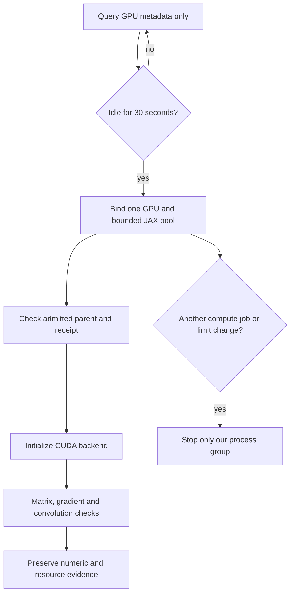

# English GPU runner: wait first, then verify

**The separate CUDA environment is installed. GPU execution still needs admission.**

| Requirement | State | Scope |
| :--- | :--- | :--- |
| Separate environment | ✅ 51 locked versions match | Existing CPU environment preserved |
| GPU admission/process guard | ✅ 13 tests pass | Simulated GPU telemetry + real process isolation |
| Backend parent/device binding | ✅ 4 tests pass | Refuses unadmitted processes, wrong devices and allocation overrides |
| Real GPU backend smoke | ⏳ Waiting for idle resources | No CUDA initialization before admission |
| Whistle GPU training | ☐ Not implemented or started | Existing student trainer remains CPU-only |



The first live three-minute window ended `not-started` because the selected
GPU remained above its utilization threshold. No child was launched. A separate
one-hour admission window is now queued with the same limits. These are real
metadata observations, separate from the simulated test cases.

[Installation, test and first-admission receipt](../research/english-gpu-admission-20261031.json).

## Admission and ownership

`tools/guard_english_gpu_job.py` requires sustained GPU utilization at or below
10%, no compute process on the selected GPU, and spare GPU/host memory. Busy
samples reset the idle window. A cooperative per-device file lock prevents two
copies of this guard from reserving the same device. Device UUID binding survives
index changes; receipts use a fingerprint rather than exposing the UUID.

Defaults require 3 GiB GPU budget plus 2 GiB reserve, and 3 GiB host RSS budget
plus 2 GiB launch reserve. Runtime withdrawal checks cover other compute arrivals,
owned GPU usage, free GPU memory, group RSS, free host memory, elapsed time and
telemetry failure. Only the owned process group receives signals.

These are sampled withdrawal thresholds, **not a hardware memory partition**.
GPU activity can change between samples. The guard does not evict or suspend
other jobs. Unit tests verify decisions with simulated GPU samples; their real
process tests demonstrate that withdrawing an owned child preserves an unrelated
process. Successful tests do not establish actual CUDA execution.

## Allocation, caches and smoke checks

The guard binds `CUDA_VISIBLE_DEVICES` to one device and gives JAX a 2 GiB BFC
pool by default. The fraction sizes that pool, not all driver/library allocations;
whole-process usage is monitored separately. JAX, CUDA and Triton caches are
explicitly placed under the supplied workdata cache root. The child does not
inherit alternate allocators, CUDA-version-check bypasses or `LD_LIBRARY_PATH`.
See the [JAX memory guide](https://docs.jax.dev/en/latest/gpu_memory_allocation.html).

`tools/check_english_gpu_backend.py` checks its actual parent process, running
admission receipt, selected device, pool settings and all installed lockfile
versions **before importing JAX**. It refuses CPU fallback or multiple visible
GPUs. The numeric smoke checks matrix multiplication, a gradient and a small
convolution against NumPy. This is a backend test, not Whistle training or
recognition accuracy. An immutable copy of the admission snapshot stays beside
the result; the live parent receipt continues updating independently.

```sh
# Source the host storage environment first. Use new report/output paths.
python tools/guard_english_gpu_job.py --device 0 \
  --lock-dir "$GPU_LOCKS" --cache-dir "$GPU_CACHE" --report "$NEW_REPORT" -- \
  "$GPU_PYTHON" tools/check_english_gpu_backend.py --output "$NEW_OUTPUT"
```

The isolated environment lives at
`~/Projects/.system-cache/venvs/ackerman-english-gpu-20261031/`.
The [lockfile](../research/english-gpu-cuda13-linux-x86_64-py312.lock.txt) and
[dependency plan](../research/english-gpu-dependency-plan-20261031.json) preserve
its exact packages. Installed versions are verified without initializing CUDA.

**Next:** complete admitted backend verification, then add a GPU-capable student
training path with checked checkpoint/restart behavior. The full corpus must
finish staging and pass its audio audit. Preserve the open numeric, held-out
accuracy and physical Watch acceptance gates.
