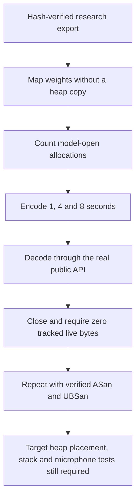

# English RAM: measured heap, physical tests still open

**✅ The eight-second host probe requests 4.17 MB at peak and releases every tracked allocation.**

| Synthetic silence | Encoder heap peak | Decoder heap peak | Peak + Watch capture buffers |
| :--- | ---: | ---: | ---: |
| 1 second | 1,824,500 B | 972,536 B | 2,848,500 B |
| 4 seconds | 2,139,004 B | 1,402,600 B | 3,163,004 B |
| 8 seconds | 4,169,028 B | 2,042,600 B | 5,193,028 B |

The actual 8,832,915-byte native-policy research export is mmap'd, matching the
Watch's flash-backed weights. The counter includes model-open allocations and
the caller's encoded output. The last column adds the Watch's two fixed
128,000-sample float capture buffers: 1,024,000 bytes total.

These are **observed host allocation requests**, not physical PSRAM use or a
worst-case bound. Stack, allocator metadata/fragmentation, task memory, UI,
networking and app heaps are excluded. Host model state is another 8,552 bytes;
the target ABI differs. The samples are digital silence and each decode emitted
one token from untrained weights, with a 128-token cap. This is not speech
quality, long-decoding or on-device acceptance.

## Sanitizer coverage: correction and replacement

| Check | Actual result |
| :--- | :--- |
| Release model probe | ✅ All three durations complete; no tracked leaks |
| GCC ASan + UBSan model probe | ✅ Same heap figures; no sanitizer errors |
| GCC deliberate heap overflow | ✅ ASan detects it and exits nonzero |
| GCC deliberate signed overflow | ✅ UBSan detects it and exits nonzero |
| Earlier Zig ASan labels | ⚠️ Do not establish ASan coverage |

The Zig combined `-fsanitize=address,undefined` build accepted the flags but a
deliberate heap overflow exited successfully. Its current profile, stage and
decoder binaries contain UBSan symbols and no ASan symbols. Requesting ASan
alone fails to link its runtime; its signed-overflow canary does abort correctly.
Earlier numerical and guard-test results remain historical evidence, but their
**ASan claims need revalidation**. The new end-to-end memory probe is the scope
of the replacement coverage; it does not retroactively cover every generated
decoder diagnostic or malformed-input case.

The replacement uses GCC 16.2.1 with matching Fedora ASan/UBSan runtimes extracted
into the workdata cache. No OS package was installed. Official Koji RPM identity,
payload digests and SHA-256 values are retained; RPM signatures were not verified.
`tools/check_sanitizer_runtime.py` requires real fault detection before a clean
model run counts as sanitizer evidence. Deliberate faults cannot write core dumps.

[Exact heap, toolchain, canary and resource receipts](../research/english-native-memory-20261031.json).

## Run it again

1. Source the host storage environment and use the locked environment's CMake.
2. Build the `wh_memory` host target; use a fresh build directory for sanitizer flags.
3. Run `tools/check_sanitizer_runtime.py --cc /usr/bin/gcc --library-dir "$RUNTIME_LIB" --output "$NEW_CANARY"`.
4. Run `tools/check_english_memory.py --binary "$MEMORY_PROBE" --export-root "$EXPORT" --output "$NEW_RESULTS"`.

Both checkers preserve existing output directories. Raw weights remain outside
Git. The probe wraps the current engine's malloc/calloc/free calls; changing the
engine's allocator path requires reviewing this coverage.

## Firmware integration remains separate

The inspected Watch source pins engine `5d1fc976b0b630406b1511161707c74f37348030`,
which predates the fail-closed `AWE1` research format. A future release needs the
reviewed engine pin and model compatibility/migration work, followed by physical
heap, stack, speed and microphone checks. This probe changes neither that pin nor
the installed production model. Full training, strict native numeric agreement
and held-out recognition remain open.
