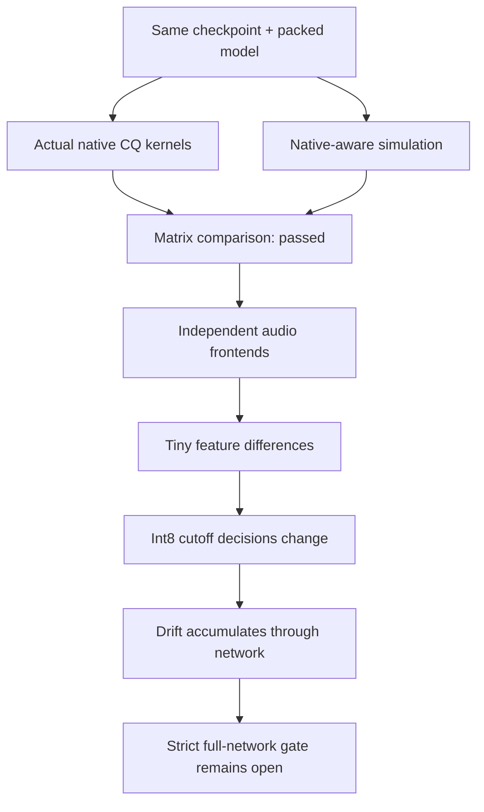
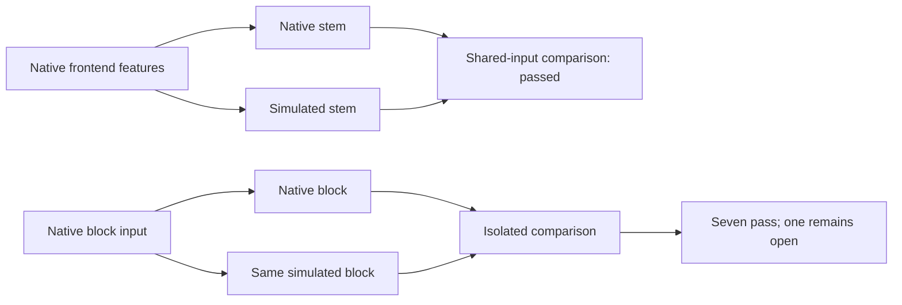

# Fast English inference: measure what the Watch runs

**✅ Kernel simulation works. ☐ Full fast-path acceptance is still open.**

**Runtime restoration corrected:** earlier network/decoder comparisons used the
checkpoint loader's default attention mode. Current checkers restore the recorded
training settings; the full fast gate still fails.
[Current results and configuration fix →](english-runtime.md)

The previous [float milestone](english-native.md) passes. Fast inference adds
different arithmetic. Upstream A8/KV8 is not an accurate simulation of this
fork's kernel, even with correctly packed weights.

| Arithmetic | Upstream training probe | Native kernel / proposed simulation |
| :--- | :--- | :--- |
| Activations | Whole input row | Hadamard-rotated groups of 128 |
| Halfway rounding | Nearest even | Away from zero |
| CQ matmul codebook | Float levels | Levels rounded to signed int8 |
| Attention query and KV | A8/KV8 simulation | Float values and caches |
| Stem pointwise projections | No activation simulation | Quantized like other CQ projections |

The shared embedding needs two views of the **same trainable parameter**:
lookup uses ordinary CQ; its output matmul uses the rounded codebook. Engram
lookup tables also retain ordinary CQ. The simulation derives an output-head
value during a forward pass; it adds no saved parameter or flash weights.

## What passes, and what does not

| Check | Result | Coverage |
| :--- | :--- | :--- |
| Actual C matrix kernels | ✅ Maximum absolute error 1.08e-6 | Four packed matrices; widths 512 / 1,280 / 2,048; two/four-bit weights |
| Rounding and gradients | ✅ | Halfway ties; padded CQ and activation gradients; lookup/output-head gradients; no input mutation |
| Stem with identical native features | ✅ Relative error 4.68e-7 | First cached natural clip |
| Blocks with identical native inputs | ⚠️ Seven of eight pass | Eighth: 0.0002398 versus unchanged 0.0002 threshold |
| Complete fast network | ☐ Strict thresholds fail | Four clips; maximum encoder error 0.007624, logit error 0.014838 |

Original upstream A8/KV8 comparison: maximum encoder error 0.010744 and logit
error 0.027752. The simulation reduces the difference, but does not close the
gate. Tolerances were not relaxed. Equal argmax IDs on these two-step weights
are not evidence of speech quality.



## How stage probes narrowed it down

On the first clip, stem output differs by only 1.65e-8 in absolute terms, but
the fresh outputs are themselves around 3e-6. Later normalization and
quantization can amplify that difference. Identical native frontend features
drop stem error to 4.68e-7 relative: a control for frontend rounding sensitivity.

Each isolated block also receives its **actual native input**, so upstream
drift cannot hide a local discrepancy. Seven pass; the eighth still misses
the strict threshold. Both cumulative and isolated results remain preserved.

The controlled replay reproduces that eighth-block discrepancy inside C itself:
a relative input perturbation of 1.03e-7 produces a 0.000239703 output change,
against the simulation's 0.000239705 difference. The two error vectors have
cosine 0.99999964; simulation versus perturbed-native output differs by only
2.02e-7 relative. Repeated unperturbed native runs are bit-identical. Float-mode
output changes only about 1.50e-7 for that perturbation. This supports an int8
rounding-boundary explanation; it does not replace the failed strict gate.

As a control, all 19 stage comparisons pass in float mode on that same clip.
This checks the diagnostic path independently of the proposed quantized policy.



## Implementation and limits

`tools/english_native_quant.py` implements experimental policy
`cq-h128-a8-away-cb8-kv-f32-v1`. It installs hooks and a stem subclass in memory
after source verification; pinned upstream files remain unchanged.
`tools/check_english_network.py --native-aware` evaluates this proposal on
existing weights. It does not make them native-policy-trained weights.

### Versioned training and restart now work

`tools/train_english_student.py --deploy-policy native-fast` selects this
simulation explicitly. The default remains `upstream-a8-kv8`. Native policy ID,
module hash, activation domain and float cache policy join the checkpoint
signature. Changed module bytes or cache assumptions are refused. The exporter
checks the same descriptor; CQ storage tests distinguish stored codebook values
from the fast kernel's additional int8 level rounding.

**✅ A fresh full-parameter step and a new-process restart both completed.**
All 29,537,627 parameters remain trainable. Both steps had finite gradients and
nonzero updates. The probe still uses just two short training clips; it is not
meaningful corpus training or evidence of recognition quality.

After RAM became free naturally, the first job completed in 146 seconds with
3,676,188,672 bytes peak observed process-group RSS. The resumed job completed
in 22 seconds with 2,492,358,656 bytes. Neither displaced another workload.
The resulting export is 8,832,915 bytes, SHA-256
`37a8d6e407c7ffbc64fb46a8340cb41b29447a528fb836590e91800b94fc819b`.
It fits the Watch's **11,010,048-byte effective model budget**, preserving the
signed app store, with 2,177,133 bytes spare. Native prefix/one-clip execution
passes ASAN/UBSAN; physical and accuracy acceptance remain open.

[Training, restart, export and resource receipts](../research/english-native-training-20261031.json)
also include the controlled rounding study. The physical model partition is
larger; use the effective budget when apps must be preserved.

**Existing checkpoints need their original trainer.** The earlier two-step
checkpoint used trainer SHA `61e2a9d4b23cdfe7e26fcd1debf833287ffaf9c9164eb6e2e1b6d830f5898455`,
retained in Git at `6fbd604`. Use that source to resume it; choose a fresh run
for the new native policy. No saved model or optimizer has been overwritten.

`tools/guard_english_job.py` replaces one-off launchers with a reusable CPU job
guard. It waits for four sustained RAM samples, lowers the job's scheduling
priority and accounts for its process group's RSS. It stops only that owned
group on memory, host-floor or time limits. Its real process tests verify that
timeouts leave a separate process running and that receipts cannot be reused.

For the first native training probe the limits are 4 GiB owned-group RSS,
2 GiB additional launch reserve, 1 GiB host floor, two CPU cores and 15 minutes.
Admission waits up to five minutes. Other workloads remain running. A bounded
probe checks training machinery; it is not full-corpus training.

```sh
# First source the host's storage/cache environment, then use a fresh report.
python tools/guard_english_job.py \
  --report "$NEW_REPORT" --max-rss-gib 4 --reserve-gib 2 \
  --host-floor-gib 1 --wait-seconds 300 --max-seconds 900 \
  -- python tools/train_english_student.py \
  --corpus "$CORPUS" --tokenizers "$TOKENIZERS" \
  --needle-source "$NEEDLE_SOURCE" \
  --audio-source-root "$ORIGINAL_AUDIO_ROOT" \
  --audio-local-root "$LOCAL_AUDIO_ROOT" --output "$NEW_OUTPUT" \
  --vocabulary 2048 --steps 1 --batch-size 1 --max-seconds 2 \
  --batch-tokens 32 --limit-train-clips 2 --deploy-policy native-fast
```

Set the path variables to the verified inputs from the
[training guide](english-student.md). The guard receipt records the full actual command.

`host/profile_probe.c` exposes individual CQ operations to host checks.
`host/stage_probe.c` includes the existing engine implementation to reach
static stages without adding a production API or device state.
`tools/english_stage_diagnostics.py` compares cumulative and shared-input stages.
Actual C stage execution passes Zig ASAN/UBSAN. No production engine arithmetic,
firmware, device model or service changed in the kernel-diagnosis milestone.
The subsequent training-policy source change is described above; its first
native-policy step and cross-process restart now pass.

[Exact numeric/resource receipts](../research/english-native-quantization-20261031.json)
preserve failures and successful controls. Raw audio, tensors and optimizer
data remain outside Git. Jobs used bounded CPU/RAM; other workloads and Bak's
hold were left alone. No target RAM, speed, power or accuracy improvement is claimed.

## Actual native-policy checkpoint: validated controls ✅

The checks above originally used upstream-policy weights. The **new two-step
native-policy checkpoint** now has its own complete four-clip and storage audit.
These are the same cached natural YouTube clips, with hashes checked before use.

| Check on the new export | Result | Meaning |
| :--- | :--- | :--- |
| All 89 packed CQ matrices | ✅ Within original storage tolerances | Packing preserves this checkpoint's quantized weights |
| Float network, four clips | ✅ Maximum encoder error 8.19e-7; logit error 7.63e-6 | Architecture and stored values agree without fast activation quantization |
| Fast network, four clips | ☐ All four miss the existing strict gate | Maximum encoder error 0.007621; logit error 0.014909 |
| Decoder given native encoder memory | ⚠️ Three pass; Levi introduction fails | First three ≤5.73e-6; Levi introduction 0.003729, above 0.002 |
| Real recognition / Watch deployment | ☐ Unverified | Two optimizer steps do not produce an accepted recognizer |

The fourth clip prevents attributing the entire mismatch to the encoder.
Both encoder and decoder rounding sensitivity need further investigation.
Identical argmax IDs here still do not establish speech accuracy. No thresholds
were changed, no failed output was overwritten, and no research model was installed.

The three jobs completed sequentially on two CPU cores at reduced priority.
Observed process-group peaks were 1.63 GB (fast), 1.45 GB (float) and 1.02 GB
(weights); none needed workload eviction or GPU allocation.

[Exact per-clip, per-matrix and resource receipts](../research/english-native-policy-validation-20261031.json).

## Decoder mismatch localized ✅

The actual native probe reproduces prior logits bit for bit. The first decoder
layer's cross-attention diverges at the eighth fixed token; self-attention,
feed-forward, the second layer and output head agree with identical inputs. Full fast-network acceptance remains open.

[Layer diagram, measured errors and next probe →](english-decoder.md)

## Next work

1. Compare first-layer cross-attention Q/K/V, cached memory and output projection at the eighth fixed token.
2. Prepare meaningful native-policy training when resources and full audio are available.
3. Preserve signature-checked checkpoint/restart behavior for the longer run.
4. Train meaningfully when resources are free, then score held-out speech.
5. Verify Watch RAM/stack, microphone behavior and signed OTA/USB recovery before release.
