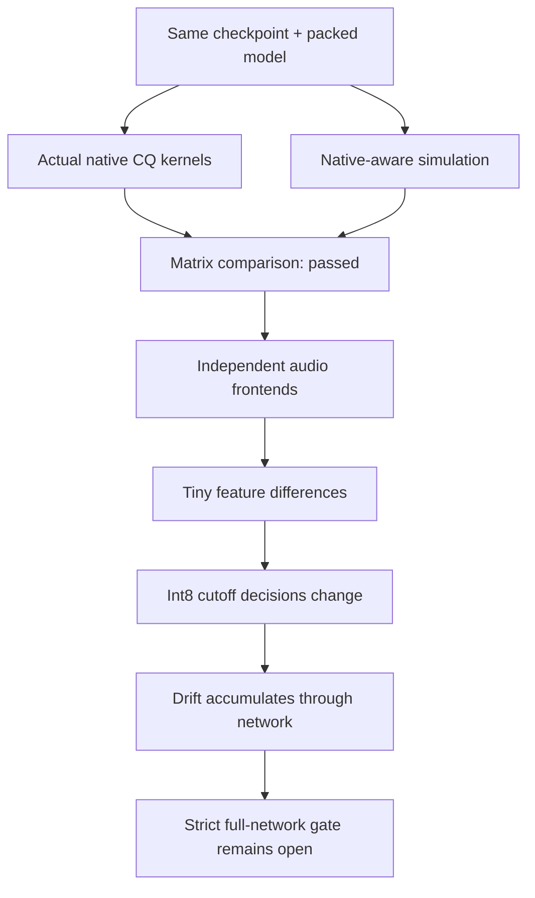
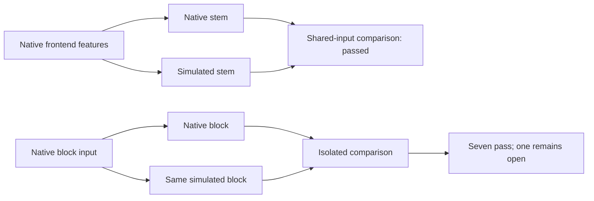

# Fast English inference: measure what the Watch runs

**✅ Kernel simulation works. ☐ Full fast-path acceptance is still open.**

The previous [float milestone](english-native.md) passes. Fast inference adds
different arithmetic. Upstream A8/KV8 is not an accurate simulation of this
fork's kernel, even with correctly packed weights.

| Arithmetic | Upstream training probe | Native kernel / proposed simulation |
| :--- | :--- | :--- |
| Activations | Whole input row | Hadamard-rotated groups of 128 |
| Halfway rounding | Nearest even | Away from zero |
| CQ matmul codebook | Float levels | Levels rounded to signed int8 |
| Attention query and KV | A8/KV8 simulation | Float values and caches |
| Stem pointwise projections | No activation simulation | Quantized like other CQ projections |

The shared embedding needs two views of the **same trainable parameter**:
lookup uses ordinary CQ; its output matmul uses the rounded codebook. Engram
lookup tables also retain ordinary CQ. The simulation derives an output-head
value during a forward pass; it adds no saved parameter or flash weights.

## What passes, and what does not

| Check | Result | Coverage |
| :--- | :--- | :--- |
| Actual C matrix kernels | ✅ Maximum absolute error 1.08e-6 | Four packed matrices; widths 512 / 1,280 / 2,048; two/four-bit weights |
| Rounding and gradients | ✅ | Halfway ties; padded CQ and activation gradients; lookup/output-head gradients; no input mutation |
| Stem with identical native features | ✅ Relative error 4.68e-7 | First cached natural clip |
| Blocks with identical native inputs | ⚠️ Seven of eight pass | Eighth: 0.0002398 versus unchanged 0.0002 threshold |
| Complete fast network | ☐ Strict thresholds fail | Four clips; maximum encoder error 0.007624, logit error 0.014838 |

Original upstream A8/KV8 comparison: maximum encoder error 0.010744 and logit
error 0.027752. The simulation reduces the difference, but does not close the
gate. Tolerances were not relaxed. Equal argmax IDs on these two-step weights
are not evidence of speech quality.

## How stage probes narrowed it down

On the first clip, stem output differs by only 1.65e-8 in absolute terms, but
the fresh outputs are themselves around 3e-6. Later normalization and
quantization can amplify that difference. Identical native frontend features
drop stem error to 4.68e-7 relative: a control for frontend rounding sensitivity.

Each isolated block also receives its **actual native input**, so upstream
drift cannot hide a local discrepancy. Seven pass; the eighth still misses
the strict threshold. Both cumulative and isolated results remain preserved.

As a control, all 19 stage comparisons pass in float mode on that same clip.
This checks the diagnostic path independently of the proposed quantized policy.

## Implementation and limits

`tools/english_native_quant.py` implements experimental policy
`cq-h128-a8-away-cb8-kv-f32-v1`. It installs hooks and a stem subclass in memory
after source verification; pinned upstream files remain unchanged.
`tools/check_english_network.py --native-aware` evaluates this proposal on
existing weights. It does not make them native-policy-trained weights.

`host/profile_probe.c` exposes individual CQ operations to host checks.
`host/stage_probe.c` includes the existing engine implementation to reach
static stages without adding a production API or device state.
`tools/english_stage_diagnostics.py` compares cumulative and shared-input stages.
Actual C stage execution passes Zig ASAN/UBSAN. No production engine arithmetic,
firmware, device model, service or training source changed in this milestone.

[Exact numeric/resource receipts](../research/english-native-quantization-20261031.json)
preserve failures and successful controls. Raw audio, tensors and optimizer
data remain outside Git. Jobs used bounded CPU/RAM; other workloads and Bak's
hold were left alone. No target RAM, speed, power or accuracy improvement is claimed.

## Next work

1. Bound remaining shared-input rounding sensitivity without relaxing existing gates.
2. Integrate native-aware training with an explicit module/signature version.
3. Verify fresh full-parameter training and checkpoint restart under resource limits.
4. Train meaningfully when resources are free, then score held-out speech.
5. Verify Watch RAM/stack, microphone behavior and signed OTA/USB recovery before release.
