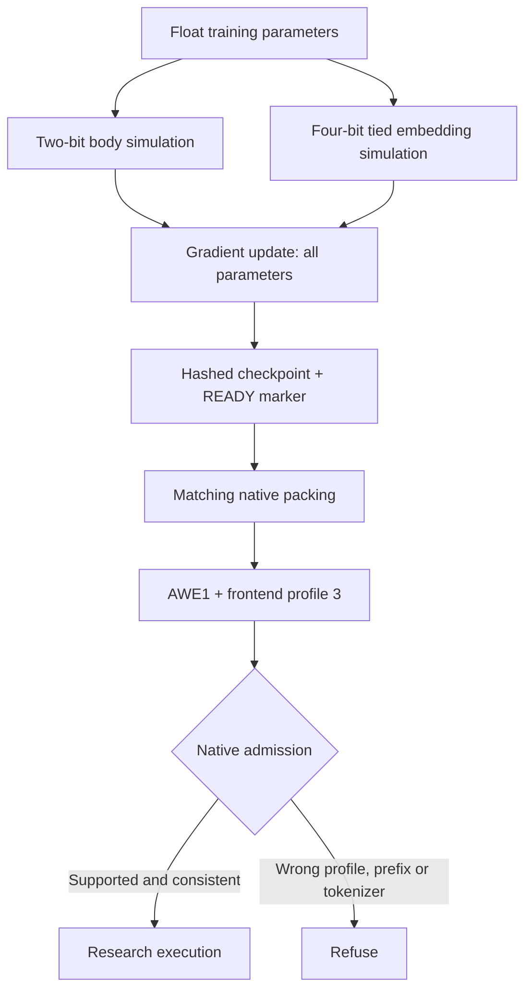

# English on the Watch: fits, still learning

**✅ An actual 8.83 MB export fits. ☐ It is not ready to recognize speech.**

| Check | State | What it means |
| :--- | :---: | :--- |
| English-only vocabulary | ✅ | 2,048 text pieces + one English prefix |
| Train, save, restart | ✅ | Two real optimizer steps; model and optimizer restored in a new process |
| Model partition fit | ✅ | 8,832,915 bytes; 3,618,925 bytes spare in the 12,451,840-byte partition |
| Native execution | ✅ | Loads, encodes and decodes; prefix checks pass with native and sanitized builds |
| Speech quality + Watch acceptance | ☐ | Full training, held-out scores, target memory and physical tests remain open |

## The route to a release

```mermaid
flowchart LR
    A[English corpus] --> B[Training-only tokenizer]
    B --> C[Fresh English weights]
    C --> D[Mixed precision training]
    D --> E[Checkpoint + restart]
    E --> F[8.83 MB native export]
    F --> G[Whole-network numerical comparison]
    G --> H[Full training + held-out accuracy]
    H --> I[Watch RAM + microphone tests]
    I --> J[Release candidate]
```

The two-step probe checks the machinery. It does not establish convergence,
word accuracy or a working character conversation. Installed firmware and its
production model are unchanged by this research.

## Small without cutting out the network

| Choice | Current research configuration |
| :--- | :--- |
| Network | 29,537,627 trainable parameters; dim 512; eight encoder and two decoder layers |
| Body weights | Two-bit codebook quantization, simulated during training |
| Shared input/output embedding | Four-bit, also simulated during training |
| Frontend | Profile 3: symmetric Hann, raw input gain, stable log features |
| Container | Distinct `AWE1` tag; older engines refuse it gracefully |

The all-four-bit export was 15,869,843 bytes and did not fit. The mixed policy
produced the predicted 8,832,915-byte artifact without removing layers or Engram.
The earlier post-hoc two-bit embedding experiment remains rejected: it worsened
word errors. That experiment is separate from this matched training/export path.

## Evidence you can inspect

| Check | Result | Limit |
| :--- | :--- | :--- |
| Export guards | 26 focused Python tests pass | Format/checkpoint guards, not ASR accuracy |
| Container admission | 19 cases pass | Includes profile 3 and older-engine refusal |
| Quantization math | Maximum fixture error 3.36e-8 | Not whole-network numerical parity |
| Frontend parity | All six cases pass; maximum real-clip error 6.35e-5 | Four cached natural clips + numerical silence/quiet noise |
| Legacy regression | Encoder, IDs, score and every checked logit bit-identical | Four clips, 61 prefix positions × 8,193 rows |

The profile-2 comparison exposed a real quiet-audio problem: float32 mean
reduction amplified tiny offsets into false features. Profile 3 uses
`log1p(power / 2^-24)` and an anchored mean. Removing a constant before
normalization preserves the intended feature definition while avoiding that
offset. Silence now compares exactly; quiet-noise error is 2.39e-6. The same
absolute/relative tolerance (0.002) was retained. Profile 1 keeps its original
arithmetic, confirmed by the legacy regression.

The native probe passes prefix/teacher-forcing consistency and real-clip
execution in release and Zig ASAN/UBSAN builds. This is not a comparison of the
entire JAX network against C. GCC sanitizer libraries were unavailable on this
host; Zig supplied the sanitizer runtime. Host state size remains 8,552 bytes;
Watch RAM, stack, speed and power have not been measured for this model.

[Numeric receipts and exact hashes](../research/english-native-20261031.json)
include both training steps, the export, frontend, quantization, admission and
legacy comparisons. Raw audio, optimizer files and model weights stay outside Git.

## Workload policy and next gates

**Wait for free Alienware resources; keep other workloads running.** Bak's
shutdown/service hold remains in force. No serving model eviction or audio pause.

The bounded CPU probe started only after spare RAM appeared. It used two CPUs,
a 3.5 GiB child RSS ceiling, a 1 GiB host available-memory floor and a 15-minute
bound. Step one peaked at 3,304,222,720 bytes; resumed step two peaked at
2,469,711,872 bytes. Both completed with finite gradients and nonzero updates.
Two losses on different examples do not establish learning quality.

1. Compare full-network trainer and native outputs before investing in full training.
2. Train meaningfully when resources and the complete corpus are available.
3. Score held-out English, app requests and character names against the baseline.
4. Measure Watch memory/stack and test real microphone interactions.
5. Release only after those gates pass, with USB and signed OTA recovery intact.

## Developer entry points

| Task | Source |
| :--- | :--- |
| Features + quantization | `tools/english_features.py`, `tools/english_precision.py` |
| Train + export | `tools/train_english_student.py`, `tools/export_english_student.py` |
| Native loader/frontend/decode probe | `host/profile_probe.c` |
| Checks | `tools/check_english_{frontend,precision,native_admission,native_legacy}.py` |
| Size planning | `tools/estimate_english_precision.py` |

Use a fresh output directory for every attempt. Preserve the exact trainer,
feature and precision module hashes when resuming: changing any of them
intentionally invalidates checkpoint compatibility. The pinned upstream source
is verified before import; the stable feature function is installed in memory,
without modifying that source archive. See the [training guide](english-student.md)
for corpus inputs and commands.
