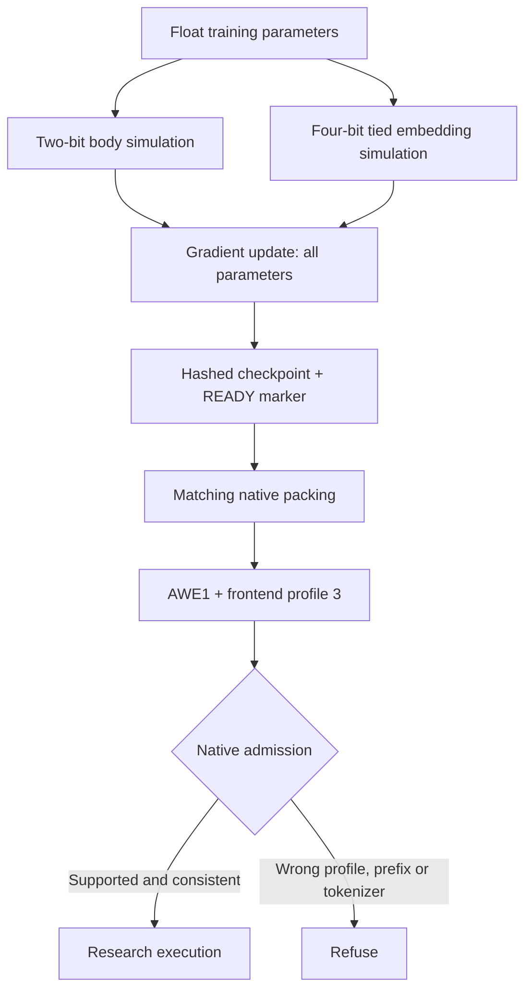
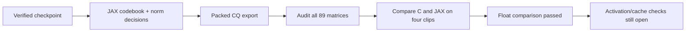

# English on the Watch: fits, still learning

**✅ An actual 8.83 MB export fits. ☐ It is not ready to recognize speech.**

| Check | State | What it means |
| :--- | :---: | :--- |
| English-only vocabulary | ✅ | 2,048 text pieces + one English prefix |
| Train, save, restart | ✅ | Two real optimizer steps; model and optimizer restored in a new process |
| Model partition fit | ✅ | 8,832,915 bytes; 3,618,925 bytes spare in the 12,451,840-byte partition |
| Native float execution | ✅ | All 89 CQ matrices and encoder/decoder outputs agree with the trainer on the checked cases |
| ESP32-S3 source/ABI compile | ✅ | All five engine files compile; target state remains 8,456 B; full linking/runtime acceptance open |
| Speech quality + Watch acceptance | ☐ | Activation/cache quantization comparison, full training, held-out scores and physical tests remain open |

The latest [native-policy two-step probe and restart](english-native-quantization.md)
also export to 8,832,915 bytes. With the Watch's signed app store preserved,
the effective model budget is 11,010,048 bytes, leaving **2,177,133 usable bytes**.
The larger partition figure above describes physical space, not permission to
overwrite the app-store carve-out.

## The route to a release

```mermaid
flowchart LR
    A[English corpus] --> B[Training-only tokenizer]
    B --> C[Fresh English weights]
    C --> D[Mixed precision training]
    D --> E[Checkpoint + restart]
    E --> F[8.83 MB native export]
    F --> G[Float network comparison: passed]
    G --> Q[Activation + cache quantization checks]
    Q --> H[Full training + held-out accuracy]
    H --> I[Watch RAM + microphone tests]
    I --> J[Release candidate]
```

The two-step probe checks the machinery. It does not establish convergence,
word accuracy or a working character conversation. Installed firmware and its
production model are unchanged by this research.

## Small without cutting out the network

| Choice | Current research configuration |
| :--- | :--- |
| Network | 29,537,627 trainable parameters; dim 512; eight encoder and two decoder layers |
| Body weights | Two-bit codebook quantization, simulated during training |
| Shared input/output embedding | Four-bit, also simulated during training |
| Frontend | Profile 3: symmetric Hann, raw input gain, stable log features |
| Container | Distinct `AWE1` tag; older engines refuse it gracefully |

The all-four-bit export was 15,869,843 bytes and did not fit. The mixed policy
produced the predicted 8,832,915-byte artifact without removing layers or Engram.
The earlier post-hoc two-bit embedding experiment remains rejected: it worsened
word errors. That experiment is separate from this matched training/export path.

## Evidence you can inspect

| Check | Result | Limit |
| :--- | :--- | :--- |
| Export guards | 26 focused Python tests pass | Format/checkpoint guards, not ASR accuracy |
| Container admission | 19 cases pass | Includes profile 3 and older-engine refusal |
| Quantization math | All 89 actual CQ matrices pass; maximum error 1.23e-7 | Eager float weight comparison; activation/cache checks remain open |
| Frontend parity | All six cases pass; maximum real-clip error 6.35e-5 | Four cached natural clips + numerical silence/quiet noise |
| Legacy regression | Encoder, IDs, score and every checked logit bit-identical | Four clips, 61 prefix positions × 8,193 rows |

The profile-2 comparison exposed a real quiet-audio problem: float32 mean
reduction amplified tiny offsets into false features. Profile 3 uses
`log1p(power / 2^-24)` and an anchored mean. Removing a constant before
normalization preserves the intended feature definition while avoiding that
offset. Silence now compares exactly; quiet-noise error is 2.39e-6. The same
absolute/relative tolerance (0.002) was retained. Profile 1 keeps its original
arithmetic, confirmed by the legacy regression.

The native probe passes prefix/teacher-forcing consistency and real-clip
execution in release and Zig UBSan builds (earlier ASan coverage is unverified). A separate whole-network float
comparison now passes too, as detailed below. Real GCC ASan/UBSan runtimes are now cached and fault-canary verified. The
[host heap probe and sanitizer correction](english-memory.md) record the new
scope: eight-second inference requests 4,169,028 bytes at peak, with no tracked
leaks. Host state size remains 8,552 bytes; physical Watch heap placement, stack,
speed and power remain unmeasured for this model.

### Network check: two causes found, float comparison passes

The new full-network checker caught an architectural difference that successful
execution alone could not expose. Legacy C adds interleaved sin/cos positions
before the encoder. The fresh trainer adds non-interleaved positions to decoder
memory, using a different frequency spacing. Research profiles now follow the
trainer; profile 1 keeps its original path.

The first fix made the encoder agree, but decoder logits still differed by
up to 0.00690. Auditing all 89 actual packed CQ matrices found discrepancies in
12: NumPy export arithmetic and JAX training arithmetic sometimes choose different
codebook indices or FP16 group norms near rounding boundaries. Small seeded
matrix fixtures had not exposed those full-checkpoint cases.

The exporter now uses the pinned trainer's JAX arithmetic for those decisions.
This leaves the checkpoint and its compatible training source unchanged. It
creates a new artifact and preserves the earlier failing export.

| Float comparison on four natural clips | Before either fix | Final matched export |
| :--- | :--- | :--- |
| Encoder relative L2 error | 1.31–1.36 | At most 8.05e-7; threshold 0.0002 |
| Decoder maximum absolute logit error | Up to 1.043 | At most 6.68e-6; threshold 0.002 |
| Every checked position's argmax | Same, insufficient alone | Same, with numerical agreement |
| Release acceptance | ☐ | ☐ |

No tolerances were relaxed. The checker also feeds native encoder outputs into
JAX to isolate decoder differences. It uses matched quantized
weights, FP16-rounded other parameters and float execution; A8/KV8 simulation
needs its own comparison. Eight fixed token positions include the English
prefix and ordinary vocabulary IDs; this is not exhaustive token/sequence coverage.
The position fix uses one heap row of scratch
(2,048 bytes at this model width), avoiding a second full clip buffer; target
peak RAM and speed remain unmeasured. Both failed comparison receipts and
their tested binaries remain preserved. Do not begin release qualification or
interpret unchanged argmax IDs on these random-weight probes as speech quality.

The corrected artifact remains **8,832,915 bytes**, SHA-256
`74fb673b1a564928fb3b2cd6d47cac15c8aa8d415d37804d4b6ef710222f7ade`.
[Corrected export, full weight audit and network receipts](../research/english-export-parity-20261031.json)
record the successful checks and the preceding failed weight audit. The original
[native milestone receipt](../research/english-native-20261031.json) retains the
earlier failed network comparisons; its false flags describe that earlier artifact.

[Numeric receipts and exact hashes](../research/english-native-20261031.json)
include both training steps, the export, frontend, quantization, admission and
legacy comparisons. Raw audio, optimizer files and model weights stay outside Git.

## Workload policy and next gates

**Wait for free Alienware resources; keep other workloads running.** Bak's
shutdown/service hold remains in force. No serving model eviction or audio pause.

The bounded CPU probe started only after spare RAM appeared. It used two CPUs,
a 3.5 GiB child RSS ceiling, a 1 GiB host available-memory floor and a 15-minute
bound. Step one peaked at 3,304,222,720 bytes; resumed step two peaked at
2,469,711,872 bytes. Both completed with finite gradients and nonzero updates.
Two losses on different examples do not establish learning quality.

1. Finish [native fast-path stability checks](english-native-quantization.md); kernel simulation passes, strict whole-network comparison remains open.
2. Train meaningfully when resources and the complete corpus are available.
3. Score held-out English, app requests and character names against the baseline.
4. Measure Watch memory/stack and test real microphone interactions.
5. Release only after those gates pass, with USB and signed OTA recovery intact.

## Developer entry points

| Task | Source |
| :--- | :--- |
| Features + quantization | `tools/english_features.py`, `tools/english_precision.py` |
| Train + export | `tools/train_english_student.py`, `tools/export_english_student.py` |
| Native loader/frontend/decode probe | `host/profile_probe.c` |
| Checks | `tools/check_english_{frontend,precision,network,native_admission,native_legacy}.py` |
| Size planning | `tools/estimate_english_precision.py` |

Matched packing lives in `tools/english_export_math.py`; audit actual checkpoint
weights with `tools/check_english_weight_parity.py` before network comparison.

Use a fresh output directory for every attempt. Preserve the exact trainer,
feature and precision module hashes when resuming: changing any of them
intentionally invalidates checkpoint compatibility. The pinned upstream source
is verified before import; the stable feature function is installed in memory,
without modifying that source archive. See the [training guide](english-student.md)
for corpus inputs and commands.
