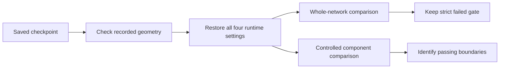

# English evaluation: restore what actually trained

**Fixed: evaluation now restores the checkpoint's recorded attention mode.**

The pinned source's `WhistleConfig.from_saved()` restores geometry but discards
`dtype`, `flash`, `remat` and `scan_unroll`. Our checkpoint trained with
`flash=False`; earlier checkers silently evaluated its weights with the loader's
`flash=True` default. Those measurements remain preserved as default-runtime
comparisons. They are not exact reproductions of the training runtime.

| Current check | Status | What it proves |
| :--- | :--- | :--- |
| Restore recorded runtime settings | ✅ Fixed + regression tested | `float32`, `flash=False`, `remat=True`, `scan_unroll=1` |
| Whole fast network, four clips | ☐ Still fails unchanged limits | Correcting the reference does not resolve the full mismatch |
| Cross-attention with identical normalized input | ✅ Every captured component passes | Query, cached K/V, gate, context and projection agree |
| Context int8 codes, identical normalized input | ✅ Match at all eight tokens | Both simulated contexts and identical-native-context controls match C preparation |
| Whole float control in recorded runtime | ✅ All four clips pass | Full fast gate remains separate |

## What the new controls establish

The native decoder trace still reproduces retained logits bit for bit. Its
captured cross-attention module also matches the original reference module
exactly. With native normalized input, the maximum gated-context relative
error is 4.99e-7 and output-projection error is 4.35e-7. Projection with identical
native context also passes. No individual query, cache or output projection
defect has been established.

A separate C query-projection replay reproduces the captured query bit for bit.
Replacing its normalized input with the standalone reference normalization
changes inputs by at most 3.30e-7 relative and native query output by at most
3.16e-7. This control does **not** reproduce a large jump. Do not claim it proves
normalization caused the composed-path mismatch.

The composed first-layer path still misses its strict limit. The next comparison
must preserve that composition and its compilation boundaries; agreement of
separate components does not establish whole-network agreement. Earlier
[layer/sublayer diagnostics](english-decoder.md) remain evidence for the runtime
mode stated by their source, with the loader-default qualification above.

The corrected float control completed on two CPU cores with a 3 GiB cap and
2 GiB launch reserve; observed process-group peak was 1.41 GB. An earlier guard
was superseded before launching a child because its 4 GiB cap required more
admission headroom than these measured controls need. That original receipt and
its explicit terminal supersession remain preserved. Other workloads kept running.

[Exact runtime, network, component and resource receipts](../research/english-recorded-runtime-20261031.json).

## Implementation and remaining work

`tools/english_runtime.py` checks geometry against the training signature,
restores the four execution settings, and refuses missing or malformed settings.
The whole-network and decoder checkers record these values and the helper hash.
No checkpoint, optimizer, native arithmetic or installed model changed.

The host generator now adds thirteen capture calls, including actual C Q8
preparation replay. Five tests verify capture-only source changes and refuse
stale/ambiguous anchors; four runtime tests cover the loader-default regression,
missing settings, geometry mismatch and malformed settings. Eight generated
probe checks pass Zig ASAN/UBSAN. Raw tensors stay outside Git.

**Next:** compare composed normalization/quantization execution while preserving
passing primitive and component controls. Full training, held-out recognition
accuracy and physical Watch acceptance remain open.
