# English student: training checkpoint

> ⏸️ Parent requested a temporary pause on 2026-10-30. Resume explicitly before starting more work.

| Feature | Status |
| :--- | :--- |
| ✅ English corpus | 100.59 hours admitted; train, validation and test kept separate |
| ✅ English vocabularies | 8,192 / 4,096 / 2,048 pieces; trained only on training text |
| ✅ Full neural training path | Fresh English-only parameters; no frozen multilingual base |
| ✅ Input and checkpoint guards | 22 focused tests pass |
| ✅ Cross-process restart | Step one saved; a new process restored model + optimizer and completed step two |
| ☐ Usable speech recognizer | Accuracy, native export and Watch acceptance still required |

```mermaid
flowchart LR
    A[Verified English corpus] --> B[Training-only tokenizer]
    B --> C[Fresh English-only model]
    C --> D[Bounded CPU training]
    D --> E[Model + optimizer checkpoint]
    E --> F[Resume in a new process]
    F --> G[PAUSE: preserve evidence]
    G -. explicit resume .-> H[Full training + held-out evaluation]
    H --> I[Native export + Watch tests]
```



## What this milestone proves

`tools/train_english_student.py` trains all 29,537,627 parameters of the full
512-dimensional, eight-encoder/two-decoder configuration. The tested vocabulary
has 2,048 English text pieces plus one English language tag. Parameters start
fresh; no multilingual checkpoint is inherited. Four-bit quantization-aware
training uses the pinned source's activation/KV simulation.

The CPU probe uses two unmodified public LibriSpeech training clips, each at
most two seconds, with a 32-token batch budget. It is a pipeline check, not
training on the complete corpus or evidence of speech quality. No firmware or
production model is changed. The separate two-bit embedding experiment remains
rejected because it worsened word errors.

First-step loss was 9.1278; resumed-step loss was 8.7323 on a different selected
training example. These two values do not establish accuracy or convergence.
Both steps had finite gradients and nonzero updates. Peak process RSS was
2.29 GiB. [Exact numeric evidence](../research/english-neural-probe-20261030.json).

## Design and safety of the research path

Audio is loaded lazily, hash checked, decoded as mono 16 kHz and validated before
use. Over-budget clips are excluded whole; neither audio nor transcripts are
silently truncated. Global-step sampling continues across process restarts.
Validation and test data do not train the tokenizer or neural parameters.

Each checkpoint stores model safetensors, optimizer msgpack, a hashed manifest
and a final READY marker. Incomplete or changed files are refused before loading.
Resume also checks parameter/optimizer shapes and dtypes, exact input hashes,
configuration, package versions and training script hash. Keep the exact script
when resuming; choose a fresh output directory for every attempt.

The trainer explicitly selects CPU. Memory/time enforcement belongs to its
external launcher; the trainer alone does not impose an RSS or wall-time limit.
The tested launcher used two CPUs, a 4 GiB child RSS cap, a 1 GiB host available
memory floor and a 15-minute limit, with at least 6 GiB available at launch.
Occupied GPU models and user audio playback were left running.

## Reproduce after explicit resume

Use the retained source archive at Needle commit
`b4fc11b04f1852888d375c8c6dfbaca44572d014` (archive SHA-256
`74c157ce6fd599691dd4fd3ae0a2218b03507a9ec3fcbc57adc798767fb49f86`).
Place an exact copy of `research/needle-source-20261030.json` at the extracted
source root as `ACK_SOURCE.json`. The trainer verifies its hash and every listed
model Python file. It imports the model modules without running the agent facade.
The archive is retained locally; this command does not fetch it or any model.

The tested isolated environment uses Python 3.12.14, JAX/jaxlib 0.12.0.1,
Flax 0.12.12, Optax 0.2.8, NumPy 2.5.4, safetensors 0.8.0,
SentencePiece 0.2.2 and SoundFile 0.14.0. Exact provenance is in the result receipt.
Use the verified corpus and tokenizer catalog produced by the
[corpus workflow](english-corpus.md).

```sh
python tools/train_english_student.py \
  --corpus "$CORPUS" --tokenizers "$TOKENIZERS" \
  --needle-source "$NEEDLE_SOURCE" \
  --audio-source-root "$ORIGINAL_AUDIO_ROOT" \
  --audio-local-root "$LOCAL_AUDIO_ROOT" \
  --output "$NEW_OUTPUT" --vocabulary 2048 \
  --steps 1 --batch-size 1 --max-seconds 2 \
  --batch-tokens 32 --limit-train-clips 2
```

Run under the retained resource guard. To continue, pass
`--resume "$PREVIOUS_OUTPUT/step-00000001"` with otherwise identical settings.
Do not overwrite earlier output or change the trainer between checkpoint and
resume. Run `python -m unittest discover -s tests -p 'test_english_*.py'` for guards.

## Coming after the pause

1. Arrange an explicitly authorized GPU window or another training host; Bak is held off.
2. Train beyond this tiny pipeline probe and score held-out English speech and real names.
3. Implement and verify native export for the new vocabulary IDs; measure actual artifact size.
4. Pass Watch RAM/stack, microphone and accuracy gates before any release.

Check `PAUSED.md` for exact retained output paths and the latest resume point.
