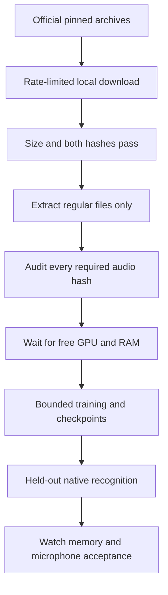

# English training: make the full run possible

**5,305 held-out clips are local and hash-verified. The training archive is downloading.**

| Requirement | State | Evidence |
| :--- | :--- | :--- |
| Full local corpus | ⬇️ Training archive downloading | Validation 2,694 / 2,694 and test 2,611 / 2,611 hashes pass |
| Local source acquisition | ⬇️ Active | Official HTTPS archives; exact size + MD5 + SHA-256 before extraction |
| Separate CUDA environment | ✅ 51 packages resolved and hash-locked | No installation or GPU execution yet |
| GPU training runner | ☐ Needed | Existing trainer intentionally forces CPU |
| Meaningful training and acceptance | ☐ Not started | Requires full data, resource admission and later accuracy/device gates |

## What the audit found

| Split | Required clips | Initially present and verified | Missing |
| :--- | ---: | ---: | ---: |
| Training | 28,539 | 2 | 28,537 |
| Validation | 2,694 | 2 | 2,692 |
| Test | 2,611 | 0 | 2,611 |

`tools/audit_english_training.py` verifies the corpus manifests, training-only
tokenizer and pinned model source before checking every mapped local file.
It does not initialize JAX or a GPU context. Missing/corrupt lists stay beneath
the chosen build output, without transcript text. Four focused tests cover sparse
caches, changed bytes, empty splits and symlink escape refusal.

The GPU snapshot is a point-in-time observation, not an idle admission or a
reservation. The working environment has no JAX CUDA plugin. No training can be
inferred from an idle utilization reading or from a successful dependency solve.

The follow-up audit of the new audio root verifies all **5,305 required
validation/test clips**, totaling 10.63 hours. Training files in that new root
remain absent until the final archive is verified and extracted. The original
four-file probe cache is preserved separately.

[Initial and follow-up exact audits](../research/english-training-readiness-20261031.json).

## Full audio, without touching Bak

`tools/stage_english_audio.py` uses the retained corpus receipt's exact archive
sizes, official MD5 values and previously recorded SHA-256 values. It downloads
validation first, then test, then training. The total pinned archive payload is
7,071,899,769 bytes. Downloads are limited to 8 MiB/s and partials are retained.
Extraction reuses the existing regular-file-only helper; archive links and
traversal are refused. Four integrity tests check valid, truncated and changed
archive bytes.

The source is [OpenSLR LibriSpeech](https://www.openslr.org/12/). Source licenses
are retained during extraction. No Bak command, remote dataset mutation or
rewrite of the existing four-file probe cache is involved.

Current local job:

- Status: `build/training-readiness-20261031/staging-v1/status.json`.
- Archives: `~/Projects/.system-cache/datasets/librispeech-20261031/`.
- New audio: `~/Projects/.system-cache/ackerman-english-training/full-audio-20261031/`.

Rerun the auditor against the new audio root after staging completes, keeping
the original origin prefix and manifest/tokenizer bytes. A successful archive
download alone does not establish that every required local clip is ready.

## CUDA dependency preparation

The [51-package lock](../research/english-gpu-cuda13-linux-x86_64-py312.lock.txt)
was resolved from official PyPI for Linux x86_64 / Python 3.12. It retains the
CPU environment's exact JAX, jaxlib, Flax, Optax, NumPy, safetensors,
SentencePiece and SoundFile versions. Wheel hashes are required. The resolver
cached dependencies but did not install them or acquire a GPU.

[Dependency-plan receipt](../research/english-gpu-dependency-plan-20261031.json).

The [JAX installation guide](https://docs.jax.dev/en/latest/installation.html)
documents CUDA 13 support and its driver/device requirements. Dependency
resolution is separate from a verified backend. Future GPU jobs also need an
admission guard and an explicit allocation policy: JAX normally preallocates
75% of device memory. Its pool fraction is not a hard cap on all process GPU
allocations. See the [JAX memory guide](https://docs.jax.dev/en/latest/gpu_memory_allocation.html).

**Next:** implement bounded GPU admission and a separate locked environment,
then verify a backend smoke test only when resources are free. Preserve other
workloads. Full numeric, held-out speech and physical Watch gates remain open.
