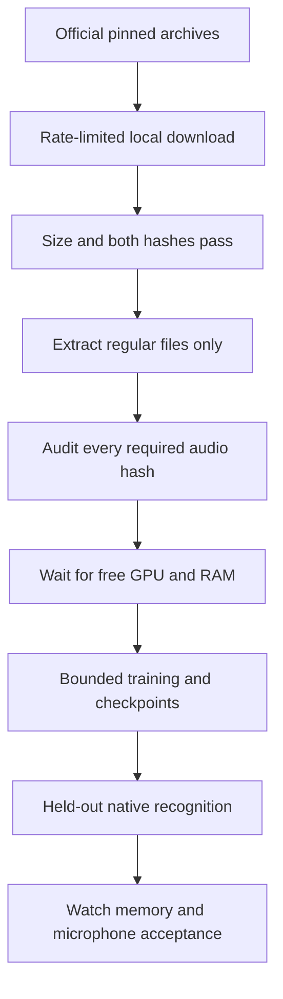

# English training: make the full run possible

**All audio is local. Short-clip GPU training and checkpoint recovery pass; the full-shape resource probe is running.**

| Requirement | State | Evidence |
| :--- | :--- | :--- |
| Full local corpus | ✅ Complete | Training 28,539; validation 2,694; test 2,611 hashes pass |
| Local source acquisition | ✅ Complete | All three archives passed exact size + MD5 + SHA-256 before extraction |
| Separate CUDA environment | ✅ Installed; all 51 versions match | CPU environment preserved; actual backend checks pass |
| GPU execution and recovery | ✅ Short-clip path verified | Two fresh CUDA updates, READY snapshots and new-process resumed update 3 pass |
| Meaningful training and acceptance | ☐ Not started | Requires full data, resource admission and later accuracy/device gates |

## What the final audit verified

| Split | Required and verified clips | Verified hours | Missing / corrupt |
| :--- | ---: | ---: | ---: |
| Training | ✅ 28,539 | 100.59 | 0 / 0 |
| Validation | ✅ 2,694 | 5.31 | 0 / 0 |
| Test | ✅ 2,611 | 5.32 | 0 / 0 |

`tools/audit_english_training.py` verified the corpus manifests, training-only
tokenizer and pinned source, then every required local audio hash. It did not
initialize JAX or CUDA. Four focused tests cover sparse caches, changed bytes,
empty splits and symlink escape refusal. The original four-file probe cache is
preserved separately.

The audit ran in the CPU environment, which has no CUDA plugin. The separate
51-package CUDA environment is installed; its real matrix, gradient and convolution checks now pass.
A GPU snapshot does not reserve resources or establish execution.

[Final full-corpus and terminal resource receipts](../research/english-full-corpus-readiness-20261031.json).
[Earlier sparse and held-out audits](../research/english-training-readiness-20261031.json).

## Full training shape: every clip still included

| Training setting | Verified plan |
| :--- | :--- |
| Dataset | ✅ All 28,539 training clips / 100.59 hours |
| Audio shape | 25 seconds; longest actual clip 24.525 seconds |
| Token budget | 160; longest actual sequence 150 tokens |
| Excluded or truncated | ✅ Zero |
| One epoch, batch size 1 | 28,539 updates; deterministic shuffle visits each clip exactly once |

The tighter shape preserves the same ordered selection hash as the original
30-second / 320-token plan. It reduces padding, without claiming a measured
speedup. The sampler's next-epoch offset was also checked. Validation/test clips
remain outside the training selection. A resource window is not an epoch and
must resume from its last complete checkpoint.

[Exact full-selection and epoch-plan evidence](../research/english-full-training-plan-20261031.json).
The GPU backend and short-clip save/resume path now pass. A separate guarded
25-second / 160-token update is testing the full shape before a training
campaign. The two-clip regression remains a machinery check, not the training
dataset. [Actual CUDA recovery evidence](../research/english-gpu-checkpoint-recovery-20261031.json).

## Full audio, without touching Bak

`tools/stage_english_audio.py` uses the retained corpus receipt's exact archive
sizes, official MD5 values and previously recorded SHA-256 values. It downloads
validation first, then test, then training. The total pinned archive payload is
7,071,899,769 bytes. Downloads are limited to 8 MiB/s and partials are retained.
Extraction reuses the existing regular-file-only helper; archive links and
traversal are refused. Four integrity tests check valid, truncated and changed
archive bytes.

The source is [OpenSLR LibriSpeech](https://www.openslr.org/12/). Source licenses
are retained during extraction. No Bak command, remote dataset mutation or
rewrite of the existing four-file probe cache is involved.

Completed local staging:

- Status: `build/training-readiness-20261031/staging-v1/status.json`.
- Archives: `~/Projects/.system-cache/datasets/librispeech-20261031/`.
- New audio: `~/Projects/.system-cache/ackerman-english-training/full-audio-20261031/`.

The final audit independently checked every extracted clip against the original
manifest. Archive verification and individual audio verification both pass.

## CUDA dependency preparation

The [51-package lock](../research/english-gpu-cuda13-linux-x86_64-py312.lock.txt)
was resolved from official PyPI for Linux x86_64 / Python 3.12. It retains the
CPU environment's exact JAX, jaxlib, Flax, Optax, NumPy, safetensors,
SentencePiece and SoundFile versions. Wheel hashes are required. The initial resolver
only cached dependencies. A separate environment is now installed and all 51
versions match; no GPU execution follows from installation alone.

[Dependency-plan receipt](../research/english-gpu-dependency-plan-20261031.json).

The [JAX installation guide](https://docs.jax.dev/en/latest/installation.html)
documents CUDA 13 support and its driver/device requirements. Dependency
resolution is separate from a verified backend. Future GPU jobs also need an
admission guard and an explicit allocation policy: JAX normally preallocates
75% of device memory. Its pool fraction is not a hard cap on all process GPU
allocations. See the [JAX memory guide](https://docs.jax.dev/en/latest/gpu_memory_allocation.html).

**GPU admission is implemented:** [guard behavior and backend smoke →](english-gpu.md).
Next validate the implemented
[accelerated student path](english-accelerated-training.md). Preserve other workloads. Full numeric, held-out speech and physical
Watch gates remain open.
